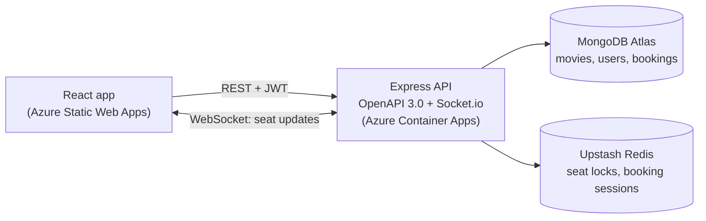

# Scoop

A movie booking site where seat picks show up live for everyone looking at the same showtime.

**Live demo:** LIVE_URL_PENDING

Log in with `demo@scoop.demo` / `ScoopDemo2026`, or press "Log in as demo user" on the login page. Payments run in demo mode, so no money changes hands. Demo data resets every night.


## How it works



When you pick seats, the API locks them in Redis for 15 minutes and sends a Socket.io event to everyone else on that showtime, so those seats show as locked on their screens. Paying turns the lock into a booking in MongoDB.

## Run it locally

You need Docker.

```bash
git clone https://github.com/CDevmina/Scoop.git && cd Scoop
cp .env.example .env   # set JWT_SECRET and REDIS_PASSWORD
docker compose up --build
```

Then load the demo movies and account:

```bash
docker compose exec backend npm run seed
```

The site is at http://localhost and the API docs are at http://localhost:5001/docs.

## Stack

- Frontend: React 18, Vite, Tailwind CSS
- API: Node.js 20, Express, oas3-tools (OpenAPI 3.0), Socket.io, JWT with bcrypt
- Data: MongoDB, Redis
- Hosting: Azure Container Apps, Azure Static Web Apps, MongoDB Atlas, Upstash
- CI/CD: GitHub Actions builds the image, deploys on every push to `main` and re-seeds the demo nightly
